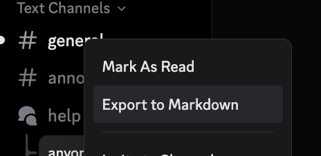
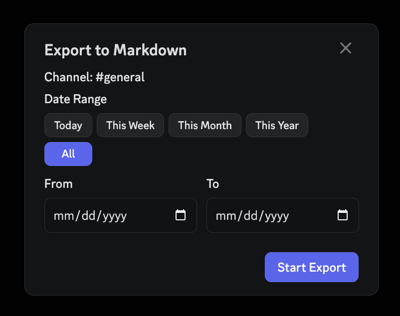

# ExportToMarkdown

Vencord plugin to export full Discord channel chat history to a Markdown file.

<p align="center">
  
  &nbsp;&nbsp;&nbsp;
  
</p>

## Install

### Vesktop (macOS, Linux, Windows via a Bash environment)

Install Node.js 22 or newer, Git, and pnpm. Clone this repository, quit Vesktop
completely, then run:

```sh
git clone https://github.com/miwgel/VencordExportToMarkdown.git
cd VencordExportToMarkdown
bash install-vesktop.sh
```

This builds Vencord with the local plugin, backs up your existing settings, selects
the custom build, and enables ExportToMarkdown. Keep the checkout: Vesktop loads
the files from `.vencord-build/dist`. Automatic Vencord binary updates are disabled
to keep them from removing the custom plugin. Rerun after updating the source.
Set `VENCORD_DIR` to reuse an existing Vencord source checkout and preserve its
other custom plugins; set `VESKTOP_CONFIG_DIR` for a nonstandard Vesktop profile.
The default creates a new build with this plugin and Vencord's built-in plugins.

For rollback, quit Vesktop and restore `state.json` and `settings/settings.json`
from the timestamped `export-to-markdown-backups` directory in the Vesktop profile
(`vencord-settings.json` is the backup of `settings/settings.json`). Your previous
build is left intact.

### Regular Discord

```sh
curl -sSL https://raw.githubusercontent.com/miwgel/VencordExportToMarkdown/main/install.sh | bash
```

This legacy installer targets regular Discord only; use the Vesktop instructions above for Vesktop.

**Already have a Vencord source tree?** Clone directly:

```sh
git clone https://github.com/miwgel/VencordExportToMarkdown.git path/to/Vencord/src/userplugins/exportToMarkdown
```

Then `pnpm build` and restart Discord.

## Usage

Right-click any channel → **Export to Markdown** → wait for progress → Download.

## Features

- Exports full channel history (not just loaded messages) via paginated API fetching
- Progress modal with cancel support
- Includes regular messages, replies, embeds, attachment links, reactions, pins, and supported system messages
- Includes edit history only for messages still cached by MessageLogger; Discord does not provide historical edits through its API
- Works with server channels, DMs, group DMs, and threads
- Configurable settings for what content to include
- Rate limit handling with automatic retry
- No API key needed — uses your active Discord session

## Settings

| Setting | Default | Description |
|---|---|---|
| Include Embeds | On | Include embed content (titles, descriptions, fields, images) |
| Include Reactions | On | Show reaction emoji and counts |
| Include Attachments | On | List attachment URLs with file info |
| Include Edit History | On | Show edit history (requires MessageLogger) |
| Include Pin Indicator | On | Mark pinned messages |
| Include System Messages | On | Include join/boost/pin notifications |
| Batch Delay | 600ms | Delay between API requests (lower = faster, higher = safer) |

## Development checks

After installing Vencord dependencies in `.vencord-build`, run `node --test tests/*.mjs`.
Tests use synthetic messages and a mocked REST client, with no Discord traffic.
The installer also runs Vencord's TypeScript check and full desktop build.

Date ranges use your local timezone and include both selected days. Closing the
dialog cancels further requests. An in-flight request may finish, but its results
will not create an export after cancellation. Repeated rate limits show an error
instead of offering an incomplete download. Forum/media parents and categories
have no export action; open an individual thread instead.

## License

MIT
